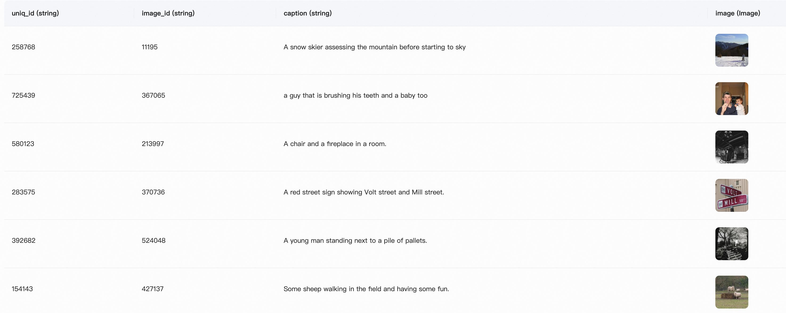
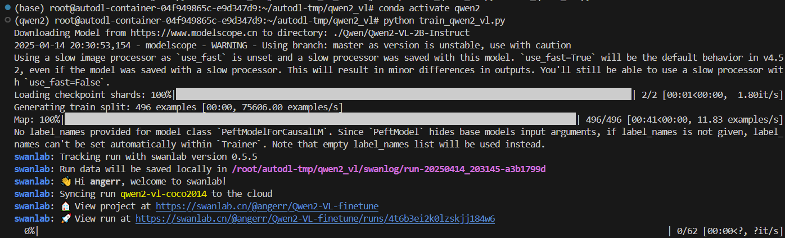
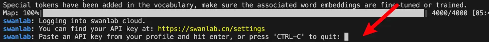
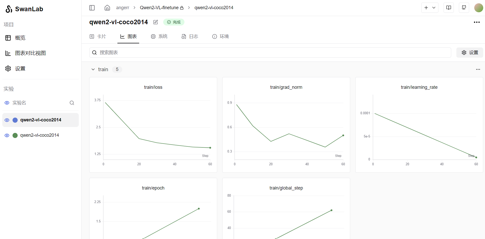
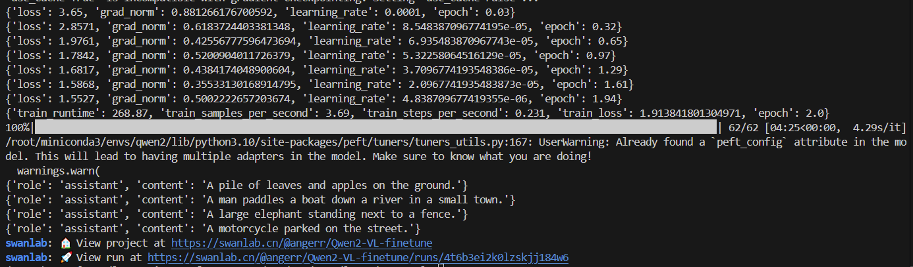

# Qwen2-VL多模态大模型LoRA微调实战
**本项目将基于 transformers、peft 等框架，使用 Qwen2-VL-2B-Instruct 模型在COCO2014图像描述数据集上进行Lora微调训练，同时使用 SwanLab 监控训练过程与评估模型效果。**
**学会本项目，你将实现：LoRA微调多模态大模型，实现图像描述任务能力提升与风格转换（RTX 4090上训练仅需五分钟）**

模型下载参照第一周模型下载的飞书笔记

## 部署流程
### 创建并激活环境
```
conda create --name qwen2_5 python=3.10
conda activate qwen2_5
```
### 安装相关库
```
pip install -r requirements.txt

```

### 下载模型
```
mkdir Qwen2.5-VL-3B-Instruct
modelscope download --model Qwen/Qwen2.5-VL-3B-Instruct --local_dir ./Qwen2.5-VL-3B-Instruct

```

### 数据概览
数据集介绍：COCO 2014 Caption数据集是Microsoft Common Objects in Context (COCO)数据集的一部分，主要用于图像描述任务。该数据集包含了大约40万张图像，每张图像都有至少1个人工生成的英文描述语句。这些描述语句旨在帮助计算机理解图像内容，并为图像自动生成描述提供训练数据。


在本节的任务中，我们主要使用其中的前500张图像，并对它进行处理和格式调整，目标是组合成如下格式的json文件：
```
[
{
    "id": "identity_1",
    "conversations": [
      {
        "from": "user",
        "value": "COCO Yes: <|vision_start|>图像文件路径<|vision_end|>"
      },
      {
        "from": "assistant",
        "value": "A snow skier assessing the mountain before starting to sky"
      }
    ]
},
...
]
```
其中，"from"是角色，"value"是图片描述，其中<|vision_start|>和<|vision_end|>是Qwen2-VL模型识别图像的标记，中间可以放图像的文件路径，也可以是URL。
### 数据下载与转换
```
python data2csv.py

####此处已经处理好数据集，可以运行python label.py (需要填入apikey)，来根据你的需求定制属于你的专属数据集

python csv2json.py
```
### 模型训练
```
python train_qwen2_5_vl.py
```
开始训练！

如果是首次使用SwanLab，运行后会遇到提示连接SwanLab。需要先在官网注册一个账号，然后在用户设置页面复制API Key，然后在训练开始提示登录时粘贴即可，后续无需再次登录：

训练过程中可以ctrl+click进入终端中的SwanLab中查看和监控训练过程

训练结束会出现类似：


**训练代码做了以下几件事：**
1. 下载并加载Qwen2-VL-2B-Instruct模型 
2. 加载数据集，取前496条数据参与训练，4条数据进行主观评测 
3. 配置Lora，参数为r=64, lora_alpha=16, lora_dropout=0.05 
4. 使用SwanLab记录训练过程，包括超参数、指标和最终的模型输出结果 
5. 训练2个epoch

### 模型推理(如需)
记得修改填入自己的测试集路径
```
python predict_qwen2_5_vl.py
```