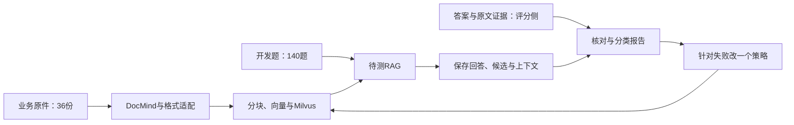

# 200题材料齐了：接下来怎样用它发现和验证改进

本次交付的是**可检查的评估材料**。200题的来源、标签与数量检查已通过；还没有真实百炼问答分数。学员完成5.6即可检查材料，完成5.11和真实入库后再运行模型评估。

## 1．先认清三个结果

| 看到的结果 | 它回答的问题 | 不能据此得出的结论 |
|---|---|---|
| `check_m06.py` 输出 `passed` | 材料是否齐全、文件是否一致、分类是否达标 | 模型答得好 |
| 一次运行的 `records.jsonl` | 模型实际答了什么、取回了什么 | 请求成功就算答对 |
| 核对后的两次配对报告 | 同一题集上哪些题改善、哪些题退步 | 一个汇总分数代表所有场景 |

可以把它们理解成：**试卷印好了 → 收到答卷 → 阅卷并比较。** 目前完成的是第一步。



答案文件不进入业务文档目录，也不进入待测RAG请求。开发集可以用于诊断；保留集的题目与答案由教师保管，在策略冻结之后独立评估。

## 2．现在实际有哪些材料

| 内容 | 实际数量 | 说明 |
|---|---:|---|
| 独立业务文档 | 36份 | PDF、Word、Excel、PPT、HTML、Markdown、TXT、CSV、图片 |
| 原始PDF | 16份、220页 | 不把Word渲染或扫描变体重复计数 |
| 格式对照变体 | 6份 | 比较转换、扫描等变化；不另算独立业务文档 |
| 开发题 | 140道 | 学员能查看问题、评分规则与原文位置 |
| 保留题 | 60道 | 学生包只有匿名分配记录，无题目正文和答案 |
| 当前冒烟子集 | 20道 | 包含在140道开发题中；已按M06B覆盖要求冻结；成员与摘要见smoke-freeze.json |

200题均完成作者来源核查。本次完整核验检查278个原文锚点，包括25个需要看图或扫描回查的区域。这里的“作者核查”不冒充独立第二人审核，也不是DocMind解析成功率。

## 3．taxonomy如何证明覆盖，又不能证明什么

Taxonomy就是分类体系。每题只有一个主任务，避免一道综合题被重复算成三道。

| 主任务 | 开发 | 保留 | 合计 |
|---|---:|---:|---:|
| 单事实查询 | 21 | 9 | 30 |
| 条件与范围 | 18 | 7 | 25 |
| 表格查询与比较 | 21 | 9 | 30 |
| 图形、图表与流程 | 14 | 6 | 20 |
| 操作与排查 | 14 | 6 | 20 |
| 计算与单位 | 14 | 6 | 20 |
| 多证据整合 | 14 | 6 | 20 |
| 时间与版本 | 10 | 5 | 15 |
| 缺依据时拒答 | 8 | 4 | 12 |
| 信息不足时澄清 | 6 | 2 | 8 |
| 合计 | 140 | 60 | 200 |

主证据格式实际配额：PDF90、Word30、Excel25、PPT20、HTML10、Markdown10、TXT5、CSV5、独立图片5。同一道题可以有多种证据载体，但在此只按主载体计数。

第二层还记录版式、证据跨度、问法与难度，例如跨页表格、扫描件、图中箭头、多轮指代、错字表达、跨文档整合。看[当前覆盖矩阵](当前覆盖矩阵.md)中的实际非零格子，不能把目标表当覆盖证明。

**仍有明确空白：**长段落、旋转扫描、页眉页脚噪声三个版式标签尚未绑定正式题；6个变体也还未完成真实模型鲁棒性评估。不是所有“任务×格式×版式”组合都已有题，某些格子仅有1题。报告需要同时展示题数；只有1题时，一次答对产生的100%不能解释为稳定能力。

## 4．新增四道开发图形题：图里的关系才是考点

| 题号 | 原件位置 | 要看什么 | 常见错误 |
|---|---|---|---|
| Q137 | D13第2页 | 三组日期与任务的竖直对应 | 把横向摆放看成执行先后 |
| Q138 | D03第7页 | 上下两排型号、各自右侧的高温框 | 丢掉上一轮已给的型号背景 |
| Q139 | D11第1页 | 底部箭头从右往左 | 按平常阅读顺序读成左→右 |
| Q140 | D15第2页 | 坐标轴与两个不同端点 | 把两端坐标拼成一个不存在的工况 |

下面是D13原始PDF第2页图块的实际渲染，不是AI重画：


对照图问自己：箭头到底连到了谁？哪里真的画了先后关系？不能因为几个框摆在一排，就替它们补出一条时间线。

本批还修正了作者图意概括过度延伸的问题。例如图中没有画出的条件不再写进“图内描述”；确实需要那些条件的题，应另列正文证据。原始PDF没有为了迁就标签而改写。

## 5．小白现在先做哪一步

### 只学到5.6：检查材料就够了

在已经创建的学生目录运行，Windows PowerShell与macOS终端相同：

```text
uv run --python 3.12 python tools/check_m06.py
```

预期有 `status: passed`、200题、140开发、60保留、空错误列表。若仍显示173题，是早期材料版本；回到5.6的导入步骤更新，保留自己的代码与修改，不改检查器要求。

检查器不存在时，先完成5.4创建学生目录、5.6导入材料。不要在另一个空目录里手工创建同名JSON假装修好。

### 已完成5.11、5.12B且真实语料全部入库：再跑140道开发题

先确认前后端可用，问答确实调用百炼，所有原件及索引版本一致，并完成20题冒烟验证。以下命令会请求本地后端，后端可能产生云调用费用；输出目录必须是一个新目录。

```text
uv run --python 3.12 python tools/run_evaluation.py run --suite development --strategy baseline --top-k 10 --final-k 5 --require-index-profile --output reports/development-b0-01
```

在学生项目根目录运行。该命令使用M11/M12B已提供的运行器；未完成这些课程时，不要提前复制执行。`--suite development`选140题，`--require-index-profile`要求保存实际生效的索引配置。运行器只向待测系统发送问题、真实历史和统一的检索设置，标签留在评分侧。

**请求完成不等于140题全对。** 按5.11生成待复核模板、检查答案和证据、记录耗时与实际用量，再按5.11补充课查看报告。不能把待复核的 `null` 批量改成 `true`。

## 6．复制给AI：用新材料做一次可解释的诊断

打开你自己的学生项目，将下面一整段粘贴给Codex。它是诊断任务，不会要求你读完Python源代码。

```text
先阅读AGENTS.md、已有规格和阶段说明。我已按5.6导入最新M06材料。
请先运行tools/check_m06.py，保存实际结果，不降低200题/140开发/60保留的要求。
若材料不齐或工具不存在，指出正确的课程步骤和报错位置，不创建假文件绕过。

材料通过后，检查materials/m06/development.jsonl确有140条开发题。
本轮只用开发题Q138说明多轮指代；不要读取保留题正文和答案。
把以下内容分开展示：上一轮已知的信息、当前问题、仍需检索的事实。
确认已有运行器向/api/ask正确传递conversation_history对应的history，
不把gold_answer_points、gold_evidence、来源答案全文或评分规则送进请求。

若还没有真实云问答记录，明确停留在材料/协议检查，不生成模型分数。
若已有记录，先展示原始回答、候选、上下文、引用，再判断失败在哪一层。
不要看见答错就同时改Embedding、切块长度和提示词。

确有代码缺陷时：
1. 在specs写最小需求、输入输出、通过条件和不应改变的行为。
2. 先补能暴露这个缺陷的测试，运行并保存真实失败。
3. 做最小修复，用同一测试验证，再跑相关回归。
4. 云效果另用相同冻结开发题集、文档和模型比较；测试通过不是效果提升。
5. 给我一个表：改变了什么、证据是什么、哪些题改善、哪些题退步、代价变化。
执行一阶段汇报一阶段；报错先解释，我不用自己猜该在哪个终端重试。
```

这里的SDD是先写清预期行为；TDD是让一个真实缺陷先变成会失败的测试。不能为了演示红灯，故意让已经正确的代码产生无关语法错误。

## 7．以后怎样公平地比较策略

```text
冻结题集与原件
      ↓
B0：当前基线 → 保存实际配置、检索轨迹、回答与评分
      ↓
查看失败属于解析、切块、召回、重排、上下文还是生成
      ↓
只选一个有依据的改动 → 独立索引或独立运行目录
      ↓
同题逐条比较：改善 / 退步 / 不变 / 待复核
      ↓
检查该类别题数、耗时、费用，再决定保留或撤销
```

若基线与优化使用不同题目、不同原件版本或评分规则，就先解释差异并重新做可比运行，不能直接把两个百分数相减。保留集只用于冻结策略后的独立检查，不看一次失败就继续针对它改到全对。

### 后期配图要求 M06-FINAL-01：从试卷到效果对比

16:9、白底、石墨灰模块、蓝色强调。三栏分别为“材料检查”“真实运行”“评分比较”。第一栏列36份文档、200题、140/60；第二栏画问题→检索→上下文→回答的可追踪链路；第三栏画按题配对的改善、退步、不变、待复核四种状态。下方单独画标准答案只进入评分侧。不得出现虚构准确率或向上的成绩曲线，不把当前材料通过画成全项目完成。

## 8．本次验证记录

- 教师来源完整检查：`reports/evaluation-final-audit.json`，200题、278个原文锚点、25个视觉/扫描区域，无错误。
- 新的学生目录：`reports/eval-final-student-import.json`，材料检查通过，临时目录已清理。
- 工具回归：`reports/eval-final-tests.log`，137项通过，另2项subtest。
- 平台：macOS、Python 3.12.12；Windows实机未验证。没有真实模型成绩，也没有独立第二人复审声明。

教师完整题集、保留题作者笔记不进入学生开发包。当前通过范围是材料和工具，后续仍需真实基线、优化和整套课的从零复现。

## M06B覆盖修订

当前20条冒烟成员已冻结，含10类主任务、9种主格式、4种行为，以及扫描、跨页表、三种视觉载体和带历史指代题。只调整5进5出的smoke标记，题干、答案、来源与split不变。当前最新核查见reports/m06b；原本节历史验证记录保留。详细操作见course/5.6B-冻结冒烟题与读懂覆盖表.md。
